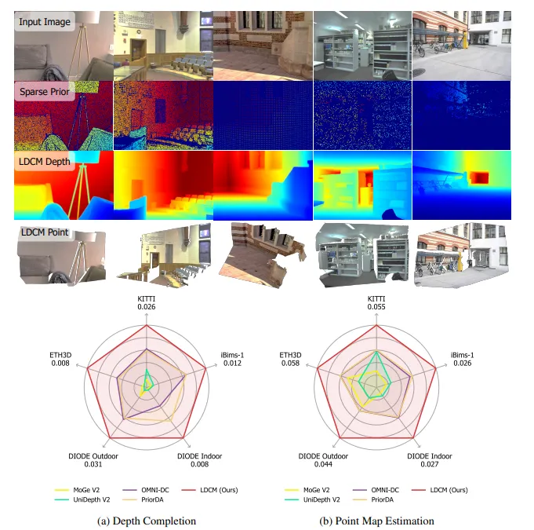

<div align="center">
  <h1 align="center">LDCM</h1>
  <p><strong>Large Depth Completion Model from Sparse Observations</strong></p>
  <p>
    <a href="https://pkqbajng.github.io/ldcm/"></a>
    <a href="https://arxiv.org/abs/2605.30115"></a>
    <a href="https://huggingface.co/pkqbajng/LDCM"></a>
  </p>
</div>

LDCM reconstructs dense metric depth from a single RGB image and sparse metric depth observations. The model combines a frozen MoGe monocular depth prior, multi-scale Poisson completion, and a DINOv2-based refinement network.

<p align="center">
  
</p>

## News

- **[2026-10-15]** Updated the **Poisson reconstruction** stage used to construct LDCM's coarse depth prior, adding robust sparse-observation weighting and edge-aware monocular guidance. The update improves both RMSE and AbsRel on the KITTI selected validation set, ScanNet++, and synthetic cases with analytical ground truth. The updated solver also runs **4.34–6.71× faster** across the tested resolutions on NVIDIA H20.

| Resolution (W × H) | Inference time (ms) | Speedup |
| --- | ---: | ---: |
| 256 × 192 | 27.23 → 6.27 | **4.34×** |
| 512 × 384 | 41.07 → 9.21 | **4.46×** |
| 518 × 345 | 62.48 → 10.88 | **5.74×** |
| 518 × 388 | 54.11 → 10.32 | **5.24×** |
| 1216 × 352 | 176.30 → 26.29 | **6.71×** |

**Depth-completion accuracy (lower is better)**

| Dataset | RMSE (m) | AbsRel (%) |
| --- | ---: | ---: |
| KITTI | 2.294 → **2.205** | 3.91 → **3.65** |
| ScanNet++ | 0.108 → **0.089** | 2.80 → **1.83** |
| Synthetic | 0.372 → **0.274** | 4.13 → **2.66** |

See the [method and implementation details](docs/poisson_completion.md).

## To Do List

- [x] Release LDCM model code.
- [x] Release Poisson completion utility.
- [x] Add bundled demo assets.
- [x] Release model checkpoint on Hugging Face.

## Installation

LDCM uses Python 3.10. Install a PyTorch build that matches your CUDA version, then install the dependencies:

```bash
git clone https://github.com/aigc3d/LDCM.git
cd LDCM

pip install torch==2.7.1 torchvision==0.22.1 torchaudio==2.7.1 --index-url https://download.pytorch.org/whl/cu126

git clone https://github.com/EasternJournalist/utils3d.git
cd utils3d
git checkout 3fab839f0be9931dac7c8488eb0e1600c236e183
pip install .
cd ..

pip install -r requirements.txt
pip install -e .
```

The bundled MoGe code depends on `utils3d`; install it from the pinned commit above.

Poisson completion can also be imported on its own. The standard installation includes Ninja, and available CUDA acceleration is selected automatically. Native reductions build on first use when a CUDA compiler is available; otherwise the solver keeps the Triton/CUDA Graph path, or uses PyTorch if Triton is unavailable.

## Pretrained Models

| Model | Download | Description |
| :---: | :---: | --- |
| LDCM | [HuggingFace](https://huggingface.co/pkqbajng/LDCM) | Main depth completion model for dense metric depth from RGB images and sparse depth observations. |

## Quick Start

The bundled demo assets can be used directly. Inputs are RGB tensors in `[0, 1]` and sparse metric depth tensors in meters. Missing sparse-depth pixels should be `0`.

```python
from pathlib import Path

import numpy as np
import torch
from PIL import Image

from ldcm import LDCMModel

device = torch.device("cuda" if torch.cuda.is_available() else "cpu")
sample_dir = Path("assets/sample_1")

image_np = np.asarray(Image.open(sample_dir / "image.png").convert("RGB"), dtype=np.float32) / 255.0
image = torch.from_numpy(image_np).permute(2, 0, 1).unsqueeze(0).to(device)

prior_np = np.load(sample_dir / "sparse_depth.npy").astype(np.float32)
prior = torch.from_numpy(prior_np).unsqueeze(0).unsqueeze(0).to(device)

model = LDCMModel.from_pretrained(
    "pkqbajng/LDCM",
    moge_path="Ruicheng/moge-2-vits-normal",
).to(device).eval()

with torch.inference_mode():
    output = model.infer(image, prior)

depth = output["depth_pred"]      # [B, 1, H, W]
points = output["points_pred"]    # [B, H, W, 3]
mask = output["mask"]             # [B, 1, H, W], MoGe valid-region mask
```

`output["mask"]` is the MoGe valid-region mask used during completion. It is not a separately trained LDCM prediction mask.

## Poisson Completion Usage

The Poisson completion utility refines a dense monocular depth prior with sparse metric depth observations. The same bundled sample can be used directly.

```python
from pathlib import Path

import numpy as np
import torch
from PIL import Image

from ldcm.moge.model.v2 import MoGeModel
from ldcm.poisson_completion import poisson_completion

device = torch.device("cuda" if torch.cuda.is_available() else "cpu")
sample_dir = Path("assets/sample_1")

image_np = np.asarray(Image.open(sample_dir / "image.png").convert("RGB"), dtype=np.float32) / 255.0
image = torch.from_numpy(image_np).permute(2, 0, 1).unsqueeze(0).to(device)

sparse_np = np.load(sample_dir / "sparse_depth.npy").astype(np.float32)
sparse_depth = torch.from_numpy(sparse_np).unsqueeze(0).unsqueeze(0).to(device)

moge = MoGeModel.from_pretrained("Ruicheng/moge-2-vits-normal").to(device).eval()

with torch.no_grad():
    moge_output = moge.infer(image, apply_mask=False)
    mono_depth = moge_output["depth"].unsqueeze(1)  # [B, 1, H, W]

    completed_depth = poisson_completion(
        sparse=sparse_depth,
        mono_depth=mono_depth,
        num_scales=4,
        thres=3.0,
        lamda=5.0,
        rtol=1e-5,
        max_iter_per_scale=[5000, 2000, 1000, 500],
        max_resolution_ratio=1.0,
    )
```

The output `completed_depth` has shape `[B, 1, H, W]`. The solver first aligns the monocular prior to the sparse metric depth and then runs multi-scale Poisson optimization from coarse to fine. An optional `confidence` map with shape `[B, 1, H, W]` can be passed to weight the monocular-gradient term during Poisson solving.

The updated solver uses robust sparse-observation weights and edge-aware monocular guidance. CUDA float32 inputs automatically use the accelerated Triton/CUDA Graph path when available, with optional native reductions compiled on first use; otherwise it falls back to the PyTorch implementation.

## License

LDCM is licensed under the Apache License, Version 2.0. See `LICENSE` for details.

## Bibtex
```bibtex
@inproceedings{LDCM,
  title={Large Depth Completion Model from Sparse Observations},
  author={Yu, Zhu and Zhao, Zhengyi and Zhang, Runmin and Qiu, Lingteng and Qiu, Kejie
          and He, Yisheng and Zhu, Siyu and Dong, Zilong and Cao, Si-Yuan and Shen, Hui-Liang},
  booktitle={ICLR},
  year={2026}
}
```
